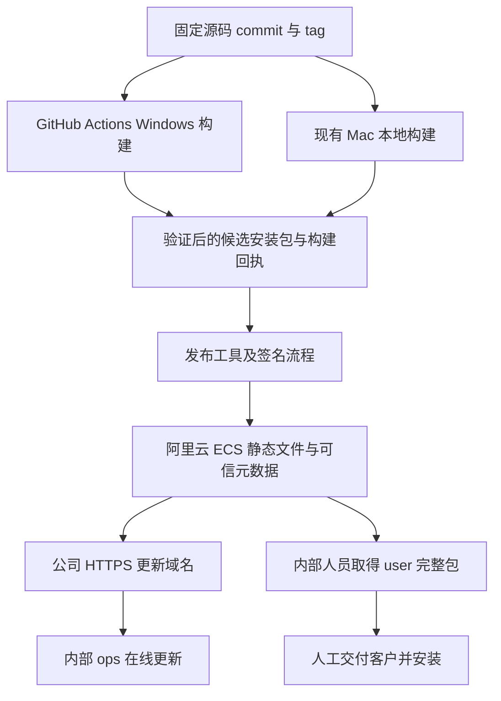

# M52 多应用更新与构建发布设计方案

初稿：2026-11-01；修订：2026-11-02。状态：用户已批准开始实现，并确认首轮使用 ECS 公网 IP。试点应用为卫星通信终端工具，包含 user 和 ops 两种构建。本文定义上位机、发布服务器、构建流水线及迁移合同；配套验收见 [M52 验收标准](M52_unified_update_release_acceptance.md)，实际实现与未验收项见 [开发记录](M52_unified_update_release_dev_log.md)。

## 设计结论

首轮沿用 GitHub Actions 构建 Windows 包，macOS 在现有 Mac 本地构建；构建验证完成后自动上传到现有阿里云 Linux ECS。源码仓库、构建节点和分发地址分别配置，后续可独立迁移。Windows 构建继续使用 GitHub 托管 Windows Runner，无需新增 Windows ECS。

user 版采用人工交付完整包，构建策略关闭应用在线检查、下载与安装入口。ops 版保留在线更新，自动检查和后台下载可配置，安装在测试人员确认并完成资源收尾后执行。客户固件 OTA、录制和设备协议功能保持各自既有合同。

现有 ECS 以 Nginx 静态 HTTPS 服务承载内部 ops 更新和受控人工取包，按少量内部同时下载验证容量。OSS/CDN 作为后续可替换后端，首轮无需采购。首轮使用该 ECS 的公网 IP 作为 HTTPS 入口，应用身份与签名信任链保持稳定；域名作为后续可选项。

在线客户端采用 TUF 验证发布元数据与文件。先建立 Windows ops 完整包的可靠安装与恢复，再增加文件级增量；每个发行版本始终生成完整包，增量只优化传输。建议只为上一正式 ops 版本提供直达最新版的增量，其他基线直接取完整包。macOS 首轮实现本地构建、自动上传及明确的手工安装流程，原生自动安装与增量另行验收。

## 现有资源与实现基线

### 服务器资源

设计初期以下资源来自用户截图；2026-11-02 已完成真实实例盘点与部署。当前服务、权限和测试结果以 [现场部署记录](M52_server_deployment_task.md) 为准。

| 项目 | 已确认事实 | 对设计的影响 |
| --- | --- | --- |
| 地域 | 华北 2 北京 | 可作为国内轻量发布节点 |
| 实例 | ecs.e-c1m1.large，2 vCPU、2 GiB | 承担小型任务与元数据服务，构建资源独立配置 |
| 系统 | Alibaba Cloud Linux 3.2104 LTS，64 位 | 运行 Linux 发布工具；Windows 包在原生 Windows 节点构建 |
| 公网 | 固定带宽 3 Mbps | 首轮直接分发给少量内部人员；完整包下载仍受该出口约束，按实测决定增量或后续 OSS/CDN |
| 磁盘 | 部署后现场空闲约 29 GiB；完整容量以实例盘点为准 | 镜像名称中的 20G 不作为实际云盘容量依据，空闲快照不代表下载/晋升峰值余量 |
| 续费 | 截图显示手动续费 | 域名、证书、实例与存储到期纳入维护 |

本仓库 v1.8.1 发布记录中的用户包为 69,813,951 B，运维包为 211,079,870 B。以 3,000,000 bit/s、单用户占满带宽且忽略协议开销估算，分别约需 3.1 分钟、9.4 分钟；多个下载共享出口。此估算不包含实际链路波动，不能作为下载速度承诺。[发布证据](v1.8.1_release_validation.md)

### 构建与更新实现

- `scripts/build_windows.bat` 和 `scripts/build_macos.sh` 共用 `scripts/build_editions.py` 与 PyInstaller spec，已有模型、edition 和冻结程序检查，可继续作为本地及 CI 的入口。
- 当前 GitHub Actions 构建 Windows 双版；macOS 在 Mac 上本地打包。PyInstaller 的产物依赖构建系统，正式 Windows 包需要 Windows 环境。[PyInstaller 官方说明](https://pyinstaller.org/en/stable/operating-mode.html)
- 当前 user 版仍在启动时调用后台更新检查，并显示检查更新按钮；公共 `ApplicationWindowActions` 与打包脚本也仍带有更新路径。关闭在线更新需要覆盖构建策略、领域入口、UI 和冻结产物，单独修改设置默认值无法落实该版本合同。
- 当前依赖多数采用 `>=`，构建时 PyInstaller 也未固定版本；需补充按平台的锁定版本和依赖摘要，才能稳定重建。目标为环境和过程可追溯，字节完全一致需另行测量。
- 安装后的 EXE、应用目录和 `.app` 已保持固定名称；GitHub Windows 更新压缩包带版本。继续区分固定安装入口与不可变的版本归档。
- 更新器已有关闭交接、载荷结构/edition/version 检查、旧版备份和状态日志。回滚、签名、续传、启动确认与线程关闭缺口由 P0/P1 修复；旧 GitHub 用户版回退缺陷随 user 在线路径退役，现有客户走人工完整安装。
- 当前手工 GitHub dispatch 输入的 tag 与实际 checkout ref 缺少明确绑定；新流水线以解析后的 commit SHA 作为所有阶段的源代码依据。

## 系统边界



ops 客户端依赖配置中的 HTTPS 入口、固定协议和可信根；首轮入口使用公网 IP，源码仓库 URL、CI 平台和后续存储后端独立配置。公共发布存储不保存源码凭据。首轮采用静态文件与元数据、单一发布 CLI；大型管理后台、动态灰度和二进制差分放在后续按实测决定。

### 组件职责

| 组件 | 权威事实 | 主要接口 |
| --- | --- | --- |
| 源码仓库 | commit、tag、代码评审和版本源 | Git；首轮 GitHub Actions，后续 GitLab 可复用脚本 |
| 构建脚本 | 本次输入、工具链、edition、OS、架构与产物摘要 | 跨 CI 复用的命令行入口 |
| 发布工具 | 候选验证、签名、渠道晋升、元数据版本 | CLI，首轮由受保护任务调用 |
| TUF 仓库 | 可信元数据、目标文件长度与摘要 | 静态 HTTPS |
| 更新客户端 | ops 已验证候选、下载和安装事务状态 | Store/事件供 UI 呈现；user 固定人工交付 |
| 平台安装器 | 文件准备、切换、启动回执、恢复 | Windows updater；macOS 后续适配 |

同一个版本包在候选、试点和正式渠道之间晋升时保持相同字节及摘要，晋升过程复用已验证产物。

## 应用身份与文件合同

### 固定身份

首个应用拟使用 `app_id=satellite-terminal-tool`，确认后作为永久机器标识；显示名称可以调整。其他上位机获得各自独立 app_id。

| 字段 | 示例 | 合同 |
| --- | --- | --- |
| app_id | satellite-terminal-tool | 产品身份，独立于仓库地址和中文名称 |
| edition | user / ops | 构建权限与功能范围，常规更新保持一致 |
| channel | stable / beta | ops 在线渠道；user 使用人工交付版本记录 |
| platform | windows / macos | 精确匹配安装目标 |
| architecture | x86_64 / arm64 | 按目标包匹配，避免跟随服务器或当前进程误选 |
| version | 1.9.0 / 1.9.0-beta.2 | 标准 SemVer；构建 metadata 不参与版本优先级 |
| build_id | commit SHA 与构建流水号 | 精确追踪构建来源；同一发行身份保持字节不可变 |
| update_protocol | 1 | 本方案的客户端业务合同版本 |
| package_format / layout_version | 7z / windows-onedir-v1 | 描述解包格式与安装目录结构，平台安装器显式准入 |
| min_updater_version | 明确版本 | 声明能够处理该安装包的最低更新器能力 |
| min_os | 经验证的最低系统版本 | 在下载前提示系统适用性 |
| config_schema | 明确版本及兼容范围 | 判断新旧程序能否共享配置及回退 |

固定安装目录沿用现有 user/ops 合同，版本显示在关于页、构建身份和报告中。新归档示例：`satellite-terminal-tool-user-windows-x86_64-1.9.0.7z`。旧客户端所需的旧包名仅在桥接发布中保留，边界见迁移章节。

### 发布目录

按用户 2026-11-02 的意见，首轮已部署 ECS 公网 IP `https://60.205.157.141`，正式 IP HTTPS 及生产空 TUF 仓库已完成客户端校验；尚无正式应用包。首轮为每个 app_id 设置独立 TUF 仓库和独立客户端信任缓存，复用实现与服务器，控制应用间的签名权限范围。

```text
/v1/apps/satellite-terminal-tool/
  metadata/                 TUF root、timestamp、snapshot、targets 与版本化历史
  targets/                  TUF 保护的渠道清单、源配置和安装包
/v1/apps/another-tool/
  metadata/
  targets/
```

渠道清单的逻辑 target 示例为 `catalog/ops/stable/windows/x86_64.json`，包含适用版本、完整包/增量包 target 路径、更新说明及兼容条件。该清单本身必须经 TUF 验证；包大小/摘要以 TUF TargetFile 为权威，清单只引用它。一致快照的实际哈希前缀与版本化命名由 TUF 库和发布工具生成。user 完整包进入受控人工交付目录及发布台账，首轮不建立 user 在线渠道。

安装包路径保持不可变。同 app_id、edition、version、platform、architecture 下出现不同字节时发布失败，修正版使用新版本。稳定的“下载最新版”入口只用于人工下载跳转，自动更新始终使用已验证的具体目标。

## 上位机更新设计

### user 与 ops 的固定策略

构建身份的 edition 是更新能力的唯一依据，领域策略和 UI 共同消费。user 版不启动在线检查线程、不显示检查/下载/安装按钮，公共更新入口返回明确的“人工安装版本”策略；修改旧设置、切换语言或工作区均保持该策略。普通构建和桥接构建结束后，user 载荷裁剪应用 updater 及在线源配置，共享必需模块按冻结测试确认；设备固件 OTA 属于另一条功能路径，继续保留。

人工交付的是完整发行包及版本说明、来源/摘要和安装说明。客户退出旧软件后替换整个应用目录或 `.app`，配置与录制目录独立保存，保留可恢复旧包；不指导将新文件直接覆盖叠加到旧目录。user 首次运行仍需处理其支持范围内的旧配置。完整包减少对旧更新器、补丁格式和补丁基线的维护，配置 schema、SDB/报告格式及设备协议的兼容范围仍须明确。

ops 默认提供启动后后台检查及手动检查。后台下载是否自动由内部设置决定；安装须等待当前批次、录制和设备操作允许收尾并由人员确认。Mac 的“已上传新版本”与“已支持自动安装”分别呈现；首轮 ops Mac 提示新版本并提供经校验的完整包下载和人工安装说明。

### 检查与下载

1. 从内置可信 root 和本地可信缓存刷新 TUF 元数据，再读取对应渠道清单；检查 app_id、edition、系统、架构和兼容版本。
2. 比较标准版本，向用户显示版本、大小、更新说明和安装条件。Windows ops 根据已验证的本地基线选择完整包或增量包，显示实际传输量；Mac 首轮仅提供完整包下载与人工安装。录制、测试、固件升级等活动由现有领域 owner 提供，更新界面直接消费该事实。
3. 后台下载到事务专属目录，显示进度、速度、剩余大小；用户可取消。低优先级下载不改变设备连接与采集状态。
4. 断点文件绑定 target 身份、总长度和摘要。恢复时验证 Content-Range；必要时用 ETag/If-Range 判断同一服务端对象。200 全量响应重写临时文件；416 先验证本地完整文件，成功即复用，否则重新下载。
5. 完成后校验可信长度和 SHA-256；切换镜像仍要求相同 target 摘要。错误范围、变化对象和摘要失败形成明确诊断；签名无效的元数据不进入候选集合。
6. 关闭更新窗口发出取消意图，等待 worker 完成并保留其 owner；同步网络读取使用有界超时，UI 保持可响应。

下载源来自内置入口或已验证源配置，限定 HTTPS。网络错误可以切换同一可信仓库的镜像；每个镜像独立完成元数据一致性验证。HTTP 重定向不能改变身份校验要求。

更新检查失败、网络隔离、系统时间异常或元数据过期，只影响新更新；现有上位机继续工作。元数据更新不通过放宽过期或签名校验恢复。

可信元数据缓存按 app_id、edition 和 repo_id 隔离，并由进程锁串行刷新；更换服务器 URL 保留同一 repo_id 的已信任版本。下载取消、进度和断点续传由传输适配层完成，替换 TUF 库不等于这些 UI/网络行为自动获得实现。

### 文件级增量的范围

当前 PyInstaller spec 采用 `EXE(exclude_binaries=True)` 与 `COLLECT` 的目录结构；Python 代码进入 EXE/PYZ，Qt 等依赖与数据资源另存文件。只调整业务代码时，未变化的依赖具备复用条件；升级 Python、Qt、PyInstaller 或资源时，增量可能接近完整包。收益必须以两份真实冻结产物验证，源码改动行数无法预测下载量。

| 方式 | 传输内容 | 首轮选择 |
| --- | --- | --- |
| 完整包 | 完整新版应用 | 每个版本始终生成，用于 user 交付、ops 首装、跨版本与恢复 |
| 文件级增量 | 新增文件、变更文件的完整内容及目标清单 | Windows ops 完整包事务通过后实施，复用同一安装器 |
| 文件内二进制差分 | 旧文件到新文件的补丁指令 | 等实际增量收益不足时再评估成熟实现 |

文件级增量比较解包后的文件，不对整个 7z 自研差分。增量包从同一已签名、已验证的新发行目录产生，包含精确基线 build_id/文件树摘要、目标 build_id、布局与增量格式版本、目标完整文件清单以及新增/替换文件。目标清单作为可信 target 绑定每项规范路径、类型、长度和 SHA-256；删除项由基线与目标清单的差集确定。先校验路径和重名/大小写冲突，再读写文件。

发布端建议只保留 `N-1 → N` 一条直达增量，按同 app、edition、平台、架构、渠道选择上一正式发行；`N-2` 及更早版本取 `N` 完整包。增量基线数量与应用配置支持期限分别管理，不形成逐版安装链。

客户端先验证候选元数据及本地基线，安装时在同盘 staging 复制并校验可复用文件、写入已验证的新文件，只保留目标清单列出的文件，原应用目录保持完整。合成后按目标完整清单再次校验整个目录，要求与完整包解出的目标文件树一致，再进入既有切换、启动回执和恢复事务。相同的是目标文件树，不要求重新压缩得到相同归档字节；用户配置与录制数据独立于补丁。

基线不适用、本地文件变化、增量格式超出能力或合成验证失败时，清理该 staging，使用同一已验证目标的完整包；回退最多一次，显示原因与新的下载量，仍可取消。可信元数据/完整包校验失败则终止。增量没有体积收益时发布端直接选择完整包。完整包回退仍要求 updater 支持目标协议；能力较旧的客户端走明确的桥接或人工完整安装。

成熟更新框架同样保留完整包：Sparkle 为具体旧版本生成增量，基线缺失或应用补丁失败时转用完整包。[Sparkle 增量更新](https://sparkle-project.org/documentation/delta-updates/)

首轮测量至少覆盖“纯业务代码修改”和“依赖升级”两个版本对，记录完整包/增量包压缩大小、生成耗时、实际下载字节、校验与合成耗时、磁盘峰值及恢复结果。增量主要节省网络，仍需要新版目录和旧版备份的磁盘空间；校验/合成耗时可能抵消部分下载收益。Mac 的框架链接、权限与代码签名须在其原生安装阶段独立处理。

### 安装与恢复

领域层统一拥有以下事务，UI 只发出检查、下载、安装、取消意图。

```text
可用更新 → 下载中 → 包已验证 → 等待安装时机 → 资源收尾
       → 同盘新目录准备完成 → 旧目录已备份 → 新目录已切换
       → 等待新版启动回执 → 更新完成
```

安装在用户确认的时机进行。运行中的批次、录制、OTA、Shell/YMODEM 继续沿用各自关闭规则，资源 owner 确认收尾后才交给 updater。安装器也重新核对冻结的包摘要和身份，防止下载验证后文件被替换。

- 在安装目录同一个文件系统建立事务专属 staging，完成复制/解压、路径约束、空间和文件校验后，再用目录 rename 切换。跨盘下载目录只作为输入，不直接成为最终目录。
- 校验归档路径、展开体积和条目数量；Windows 包拒绝逃逸路径与链接。后续 macOS 适配只接受包内合法框架链接并保留权限。
- 在安装目录之外的持久维护目录保存 journal 和可独立运行的 updater 副本；启动独立副本后再替换旧安装，避免更新器占用被替换路径。
- Windows 首轮在切换前注册按本用户登录触发的恢复任务，命令指向上述独立副本并绑定 transaction_id；注册和路径验证成功后才允许移动旧目录。机器重启登录后，该入口根据 journal 恢复安装，即使原 EXE 路径暂时不存在也可执行。当前会话内异常提供同一恢复入口的明确路径；成功确认或恢复后清除该任务，重复触发保持幂等。
- 恢复任务按已验证的安装权限运行。用户可写目录采用普通用户权限；受保护目录必须先建立具有所需权限的恢复路径，否则在切换前提示人工安装。临时下载目录与被替换安装目录都不能作为唯一恢复入口。
- journal 先记录意图再执行文件动作，动作后记录事实。安装锁按应用实例隔离；进程退出、断电后可根据 journal 与目录事实幂等恢复，原始包与最近已验证备份保留到事务成功。
- 新程序通过绑定 transaction_id、目标版本和进程的本地回执报告“配置可读、关键模块及主窗口初始化完成”。无需连接实物设备即可回执；短暂正常退出或启动失败不能判成成功。更新试运行阶段保持设备控制入口关闭，健康确认后恢复正常使用。
- 回执失败先结束本事务新进程，确认文件句柄可释放，再恢复上一安装及兼容配置。超时只能触发失败/恢复，不能推断初始化成功。
- 更新失败不修改录制文件和批次数据库；安装与用户数据保持独立目录。普通写权限不足时明确提示，提权只在实际需要的安装场景处理。

配置优先使用兼容的增量 schema；破坏性迁移必须声明兼容范围，安装前备份将修改的配置，健康确认前隔离迁移写入。回退不能让旧程序直接读取仅新版本支持的配置，也不能整目录覆盖用户新录制的数据。

自动恢复仅回到本事务之前已验证的本地安装；TUF 的可信版本缓存继续保留。正式渠道撤回有缺陷的新版本时，停止继续推荐；已经安装的用户通常通过更高应用版本的修复包恢复，服务端不能降低 TUF 元数据版本来“回滚”。

## TUF 与密钥维护

采用维护中的 TUF 客户端库，Python 侧优先 `python-tuf`。TUF 负责签名、摘要、元数据版本、有效期和信任链；业务版本筛选及本地安装事务仍由上述领域模型负责。多应用复用客户端组件与发布脚本，各应用独立初始化可信根。[TUF 元数据说明](https://theupdateframework.io/docs/metadata/) [Python 客户端接口](https://theupdateframework.readthedocs.io/en/latest/api/tuf.ngclient.updater.html)

| 角色 | 建议保管与权限 | 首轮维护策略 |
| --- | --- | --- |
| root | 离线保管；试点采用独立密钥和加密异地备份，正式多人运营可配置门限签名 | 建议 1 年有效期，至少提前 90 天检查和演练续签/轮换 |
| targets | 受保护发布环境；仅批准的发布任务和续签任务可调用 | 建议 90 天有效期，至少每 30 天检查并续签现有目标 |
| snapshot | 与 targets 权限分离的受限自动任务 | 建议 30 天有效期，至少每周刷新 |
| timestamp | 低权限常驻任务可用，只能声明已有 snapshot | 建议 7 天有效期，每日刷新；连续两次刷新失败告警 |

这些周期是运维参数提案，需结合维护频率验收；每个角色都有到期检查，不以“没有新版本”跳过续签。root 单签试点仍有单密钥风险；备份解决丢失，门限签名才提高密钥失陷容忍度。

公共文件服务进程没有签名权限。现有 ECS 可承载 timestamp/snapshot 的受限任务，但 root 和 targets 私钥保持在独立受保护环境。签名与上传身份分离，客户端只包含公钥和必要公开配置。

从旧 root 更新时保留全部连续版本 root 文件及旧/新密钥授权链；具体校验和过期处理按标准库执行。元数据历史、密钥备份与恢复演练一起维护，不能在换服务器时重新生成一个无关联 root。

TUF 签名与 Windows Authenticode、macOS Developer ID/公证分别解决更新来源与操作系统发行身份问题。macOS 当前 ad-hoc 签名不等于 Developer ID；证书接入需在相应平台阶段验收。

## 服务器部署与维护

### 首轮资源分配

| 资源 | 部署内容 | 容量与运行方式 |
| --- | --- | --- |
| 现有 Linux ECS | Nginx 静态 HTTPS、上传暂存、发布 CLI、元数据维护及探测 | 2 核 2 GiB 试点；盘点磁盘和既有业务，限制发布任务并发，下载共享 3 Mbps |
| GitHub Actions Windows Runner | 固定 Python/PyInstaller/7-Zip/依赖的原生构建 | 复用现有工作流，user/ops 独立 job，首轮无需购买 Windows ECS |
| 现有 Mac | macOS 原生构建、验证与自动上传 | 本地发行命令串联，构建失败停止上传；上传失败复用已验证产物重传 |
| 公网 IP 与 HTTPS | 当前 ECS 直接提供更新入口 | IP 证书自动续签；后续按需要增加域名或迁移入口 |
| OSS/CDN、GitLab CI 或内网 Runner | 后续容量或源码迁移选项 | 本轮保留接口合同，实际部署与演练独立立项 |

首轮发布机只处理静态文件、轻量验证与定期元数据任务，实际容量经部署测量确认。完整 GitLab 和 Windows 构建均不部署在当前 Linux 发布机；未来需要迁移 Runner 时另行评估资源。

### 文件分发

- 首轮 HTTPS IP 入口由 ECS Nginx 直接读取正式目录，内部人员按少量并发验证。2～3 台同时更新仍共享带宽；无需专门的高并发调度服务，安装锁、发布互斥和连接上限仍按基本正确性保留。
- user 包存入内部人工交付目录，由人员取得后发送客户；关闭 user 在线更新降低的是应用自动请求量，若给大量客户直接发送同一 ECS 下载链接，依然需要按实际下载量扩容。HTTPS、访问权限及实际接入条件在部署前确认；域名采购与 DNS 配置不属于首轮前提。
- ops 更新与内部人工取包使用部署确定的访问控制，例如公司 VPN；若后续采用短期授权 URL，其只作为传输入口，可信 target 身份保持。客户端不携带上传密钥或服务器管理凭据。
- 后续容量超过现有出口时再选择存储后端。IP 入口改变时先通过可信源迁移配置告知客户端；若届时使用域名，则可保持域名与不可变对象路径。CDN 私有回源和客户端访问权限分别配置。[OSS 域名与网络](https://help.aliyun.com/zh/oss/user-guide/access-and-network-overview) [CDN 加速 OSS](https://help.aliyun.com/zh/oss/user-guide/cdn-acceleration)
- 元数据采用短缓存及条件请求，timestamp 发布后主动刷新缓存；安装包和版本化历史可长期缓存。保持 Range 及正确 Content-Range/Content-Length，不在中途压缩或转换归档内容。
- 发布端先上传全部引用对象、校验可读取，再发布 targets/snapshot，最后更新 timestamp。单个对象原子写不等于整个发布原子完成；以可验证的快照关系和最后切换入口确保一致性。
- 正式发布入口按应用加互斥，发布时重读最新元数据版本，防止两个任务覆盖或降低版本。失败重试复用同一候选，冲突候选需要重新验证和签名。
- 保存包、元数据版本/root 链、发布回执、来源 commit、依赖锁、签名与权限配置的可恢复备份。存储版本历史是恢复工具，客户端信任仍由签名验证。
- 检测 IP HTTPS 证书、元数据到期、实际 GET/Range、签名验证、流量与费用；候选发布失败只产生诊断，稳定渠道继续引用已有完整产物。

## 编译发版流程

### 仓库与 CI 平台解耦

首轮 Windows 使用 GitHub Actions，Mac 使用本地发行命令。构建、校验、上传与发布分别由仓库脚本提供同一合同；未来 GitLab CI 只替换编排与源码获取，沿用包结构及身份规则。GitHub Release 可保留候选或历史桥接包，ops 新客户端的更新检查与下载使用阿里云 HTTPS 入口。

构建输入为固定 commit SHA、版本、app_id、edition、系统、架构和工具链锁。`channel` 属于发布选择，正式晋升不重打包。版本来自项目单一版本源，tag 解析结果、checkout SHA、包内版本与回执全部一致；手填版本不替代 checkout。

构建回执至少包含输入身份、UTC 时间、构建机镜像标识、Python/PyInstaller/7-Zip/依赖锁摘要、完整文件大小/SHA-256、测试和冻结程序结果。日志中移除凭据。每个 job 使用独立工作目录，避免并行 user/ops 覆盖 build identity。

### 自动上传与正式发布

Windows 发布工作流在构建 job 完成后，由独立上传 job 取得已验证产物，调用共用上传 CLI。Mac 通过明确的本地发行命令完成“固定 SHA 校验 → 构建 → 冻结验证 → 自动上传”，日常开发构建保持本地行为。Mac 已有不带版本的本地输出名称在进入上传前转换为带身份和版本的不可变发行文件名；正式构建要求工作区匹配所选 SHA，包含本地未提交修改的包只作开发产物。

首轮可采用 SSH/SFTP：上传账号仅能写候选目录，校验 SSH 主机指纹；GitHub 环境 Secrets 与 Mac 本地凭据分别保存，上传地址及目录由部署配置提供。候选目录位于 HTTPS web root 之外，每次使用唯一 release_id；路径和 tag 使用结构化参数及白名单校验，避免拼接成远端 shell。发布 CLI 用独立身份晋升，Nginx 只读正式文件。GitHub 环境级密钥的注入与日志处理按官方能力配置。[GitHub Actions Secrets](https://docs.github.com/en/actions/how-tos/write-workflows/choose-what-workflows-do/use-secrets)

上传完整包、文件清单、构建回执和可选增量，服务端校验长度/摘要并返回候选回执。发布阶段先把校验通过的文件放入不可变正式路径，完成实际 HTTPS 下载回验后，才发布引用它们的渠道元数据。中断可继续上传同一候选，失败可重传已构建产物，无需重打包；远端同名内容冲突直接失败。GitHub 到阿里云的跨境链路只影响发布上传，不进入客户更新下载路径。

“自动上传候选”与“正式发布”分为两个明确动作：上传成功保存产物；发布命令或受保护任务通过验收后才推进 ops 渠道，user 仅更新人工交付台账。构建、压缩、增量生成都在构建侧完成，当前 2 GiB ECS 只做上传接收、流式校验、文件晋升与元数据维护。Windows/Mac 按平台分别发布就绪状态，某平台尚未上传时保留该平台旧渠道，不制造缺包的新版本入口。

### 流水线阶段

| 阶段 | 工作 | 发布准入证据 |
| --- | --- | --- |
| 1 冻结来源 | 解析受保护 tag，checkout 精确 SHA，核对版本源 | source.json / 构建身份 |
| 2 源码验证 | 测试、翻译、依赖锁和工具链检查 | 测试与翻译记录 |
| 3 分平台构建 | Windows 调现有 bat，Mac 调现有 sh | 独立 user/ops 产物 |
| 4 冻结验证 | 版本/edition/模型/模块边界和启动退出 smoke | frozen-smoke 回执 |
| 5 签名与封装 | 平台代码签名、完整归档、可信文件清单；ops 增量阶段比较上一正式包并验证合成 | CRC/SHA、基线及目标文件树摘要、增量收益记录 |
| 6 候选上传 | Windows 上传 job / Mac 发行命令自动上传，服务端校验并返回回执 | candidate receipt；上传失败保留本地产物 |
| 7 安装演练 | ops 完整/增量安装与恢复；user 完整包人工替换及数据保留 | 相应安装路径的专项结果 |
| 8 正式公布 | 验证不可变路径的实际下载后推进 ops 签名渠道；user 登记人工交付版本 | 下载摘要、签名元数据、发布与交付记录 |
| 9 发布探测 | 从客户端入口检查新版本并下载验证 | endpoint probe；失败暂停扩大投放 |

合并请求执行构建/测试，受保护发行流程才获得候选上传权限，正式签名/晋升任务另设权限。构建环境与签名环境采用独立身份和目录。未来使用自建 Shell Runner 时，仓库脚本拥有其执行环境权限，仅接可信项目。[Runner 安全](https://docs.gitlab.com/runner/security/)

依赖按平台锁定并缓存 wheel，保留内部包镜像或 wheelhouse。内网流水线同时盘点 PyPI、Git LFS、子模块、工具链下载和证书服务等依赖；单独迁移 Git 仓库并不等于离线可构建。

macOS 本地发行入口复用 `build_macos.sh` 产生 ZIP，再按上述合同自动上传；ops 清单显式声明人工安装，user 按完整包交付。后续在 Apple 构建节点完成权限、框架链接、签名、公证和安装回退测试；若引入 Sparkle，发布身份仍由同一渠道清单拥有，并明确单一安装 owner。[Sparkle](https://sparkle-project.org/documentation/)

## 内网 GitLab 与网络拓扑

### 云端允许构建源码

未来源码在 GitLab 时，GitHub 托管 Runner 必须具有获准的源码访问路径：可用受控的私有发布镜像，或显式拉取允许外部访问的 GitLab 指定 SHA。核对镜像 commit/tag 与权威仓库一致，LFS/子模块及依赖也需可达。内网地址本身不能被假定为 GitHub Runner 可访问；采用镜像意味着允许该部分源码进入云端。

### 源码保留内网

若后续要求源码严格保留内网，则 GitLab、Windows Runner 与 Mac 构建机均位于内网，替换 GitHub 托管构建。发布节点通过允许的 SSH/SFTP 或 HTTPS 上传验证后的二进制产物和签名元数据到相同分发端；公网发布机不获取源码权限。该拓扑同样能实现 Mac 开发者触发 Windows 打包，属于后续迁移实施。

### 内网完全离线

构建使用内网依赖镜像。通过明确批准的介质/中转流程移交包含源 commit、产物摘要和验证证据的发布包，发布侧校验后再晋升。完全离线客户端可导入带完整可信元数据的更新包；仍执行身份、有效期和文件校验。离线范围与元数据维护周期在相应部署中共同确定。

未来迁到内网 GitLab 时，Git 历史、tags、LFS、CI 定义、Runner 注册、权限、变量和密钥逐项迁移。项目导出不覆盖所有运行配置及凭据，按所用 GitLab 版本的导出清单盘点。[GitLab 项目迁移](https://docs.gitlab.com/user/project/settings/import_export/)

## 迁移与兼容

| 变化 | 迁移动作 | 客户端影响 |
| --- | --- | --- |
| GitHub 到 GitLab 到内网 GitLab | 保留 commit/tag；按源码访问政策选择 GitHub 发布镜像或内网 Runner | 更新域名与包身份保持，客户端继续使用 |
| GitHub Windows Runner 到内网 Windows | 部署固定工具链与脚本，重新验证目标 OS/架构 | 发布合同保持，客户端继续使用 |
| 当前 ECS 到另一后端 | 复制全部目标和 TUF 历史/root 链，验证 HTTP 行为；地址改变时先发布可信源迁移配置 | 已取得迁移配置的客户端继续验证；其余保留旧入口或人工安装 |
| 首轮 ECS 公网 IP 更换 | 原入口发布签名源配置，新地址完成 HTTPS 与可信仓库校验 | 在线客户端保存新入口；原入口提前下线时，尚未迁移的旧客户端需人工安装 |
| 后续增加或更换域名 | 先在旧可信仓库发布签名源配置，客户端验证新入口后持久化 | 需先部署源迁移能力，旧入口保留至支持期结束 |
| 签名密钥轮换 | 提供连续 root 版本，按旧/新授权链验证 | 已支持 TUF 的旧客户端按标准库追赶 |

同域名迁源执行“复制与哈希核对 → 新源完整读取与更新演练 → 暂停发布写入 → 最后同步 → 单一新发布 owner → 切入口 → 双站观察”。旧源在 DNS 缓存与在途下载窗口内保持同字节只读，更新元数据按单一 owner 同步；失败可切回相同数据状态。

换域名使用 TUF 保护的 `bootstrap/sources.json`，记录迁移 generation、候选元数据/目标基址及 repo_id。客户端用既有可信根验证新站后才保存入口，公钥不能由未认证的 HTTP 重定向替换。源 generation 只能向前推进；本地永久保留一个仍受支持的恢复入口。

长期离线 ops 无法在旧 IP 或域名入口完全消失后获知新地址。迁移时维护支持期内的旧入口；未取得迁移配置的客户端提供人工可信完整包。user 始终采用人工交付。

### 旧 GitHub 客户端桥接

1. ops 发布一次支持新更新协议的桥接版本，提供现有 GitHub 命名的 ops 包和国内人工完整包。旧 ops 客户端通过既有流程或人工安装获得内置可信根；user 通过人工完整安装切换到关闭在线更新的新构建。
2. 旧 updater 自身存在回滚缺口；桥接包使用现有布局，提前在 Windows 验证旧到新。需要避免旧事务风险时采用独立安装程序/人工安装；不能声称包内新 updater 已保护安装它的旧 updater。
3. 新 ops 通过阿里云 HTTPS IP 入口检查更新，验证与安装逻辑使用新合同。user 不桥接到新在线源；已交付的旧 user 客户端在更换程序前仍可能执行原有 GitHub 检查，服务器设置无法保证远程关闭这些代码。人工交付说明记录该边界，必要时发布固定的最终旧入口说明。
4. GitHub 旧入口退出条件为已发布支持期限、存量迁移确认及国内人工恢复入口就绪，不能以新版本已发布替代迁移完成。

## 实施工作包

| 工作包 | 交付 | 依赖及出口 |
| --- | --- | --- |
| P0 版本策略与更新器修复 | user 固定人工更新、ops 领域策略；同盘 staging、恢复入口、启动回执、worker 关闭、身份/版本准入 | user 零在线更新请求；Windows 完整安装专项通过 |
| P1 可信发布协议 | app_id/edition/arch、TUF、可信文件清单、下载验证、源迁移配置 | 契约、离线、篡改及完整包恢复测试通过 |
| P2 构建与阿里云试点 | 锁定工具链、GitHub Windows 和本地 Mac 共用上传 CLI、现有 ECS 静态分发、备份维护 | 两平台自动上传候选；ops 国内下载、user 人工交付验证；无新增 Windows ECS 前提 |
| P3 Windows ops 增量 | 上一正式基线的文件级增量、完整包回退、同一安装事务 | 两类真实版本对测量；目标文件树一致；收益不足选完整包 |
| P4 桥接与首轮发布 | ops 桥接、user 人工迁移、真实恢复、IP HTTPS 证书及 root 维护 | 按首轮验收矩阵记录，声明支持范围与完整包恢复入口 |
| P5 后续扩展 | OSS/CDN、GitLab/内网 Runner、第二应用、macOS 原生更新 | 按实际需求独立实施；当前设计保留合同与后续验收项 |

P0/P1 中复用现有模块的职责，删除被替代的旧事实来源。通用协议代码首轮置于本项目；第二个上位机接入时依据真实差异提取共享库，避免先建一个功能繁重的管理平台。开始实现后创建开发记录，逐条关联本计划和验收证据。

## 部署前需补齐的现场信息

这些信息影响资源和发布策略，不阻止本设计先行评审：

- 现有 ECS 云盘容量、剩余空间、已有服务/端口，以及公网 IP 的 HTTPS 验证和自动续签条件。
- Windows 用户的实际系统/架构范围；GitHub Actions 发布权限和现有 Mac 构建架构。
- GitLab 的后续迁移时间及源码访问政策；迁移发生时再确认内网 Runner 条件。
- ops 内部下载权限与少量同时更新规模；user 人工取包/交付途径。
- 发布审批与签名密钥保管人员；Windows 发行证书、Apple Developer ID 的现有条件。

以上信息确认前不变更现有实例系统、不采购云资源、不切换正式更新域名。本文交付设计和验收合同，部署按已批准工作包执行。

## 参考方案的采用范围

- [TUF](https://theupdateframework.io/docs/metadata/)：采用可信元数据机制和库，不自行复刻签名协议。
- [Velopack](https://docs.velopack.io/distributing/overview)：参考不可变产物、渠道清单和静态 HTTP 发布流程；首轮沿用已有 PyInstaller 产物和加固后的安装器。
- [Sparkle](https://sparkle-project.org/documentation/)：macOS 原生更新阶段的候选，先验证 PySide/PyInstaller 集成和安装 owner 边界。
- [GitLab Runner](https://docs.gitlab.com/runner/install/windows/)：后续迁移时采用原生 Windows 构建节点，复用当前构建和上传脚本。
